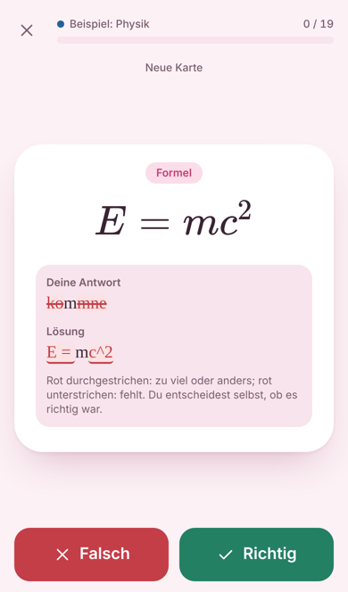
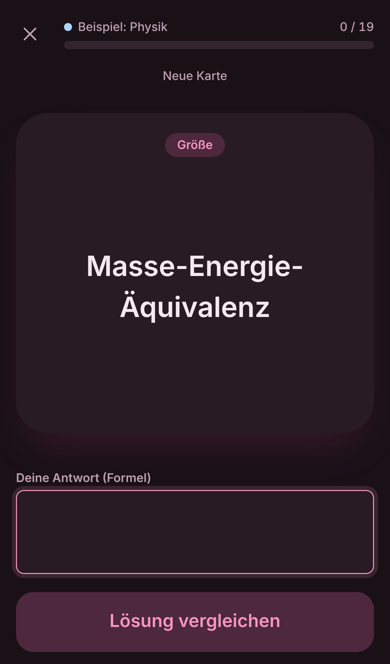

# Lernkarten – flashcards for any subject

A free, offline-first flashcard app for the iPhone (and any modern browser). Learn vocabulary in any
language pair – including right-to-left scripts such as Persian, Arabic and Hebrew – as well as
mathematical definitions, physics equations, code snippets, medical terms or history dates.

It is a Progressive Web App: open it once in Safari, add it to the Home Screen, and from then on it runs
like a native app – no App Store, no account, no server, no subscription, no ads.

The user interface is in **German**; code, comments and documentation are in English.

**Open the app:** https://saya2810.github.io/flashcard-app/

<p>
  
  
  
  
  
</p>

> Looking for the original Persian–German vocabulary trainer? See
> [The original Persian–German version](#the-original-persiangerman-version).

## Features

**Organise anything**
- Unlimited **decks** (*Stapel*), grouped by **subject** (*Fach*), each split into optional **lessons**.
- Each deck defines its two sides: label, language, writing direction (auto / LTR / RTL), font, size and
  weight – so a Persian deck looks different from a calculus deck.
- **Custom fields** per deck (transliteration, example sentence, unit, source …), shown after flipping.
- Several accepted answers per card, notes, tags and a **priority** from 1 to 5.

**Rich content**
- Markdown (**bold**, lists, tables, quotes), **LaTeX** with KaTeX (`$…$` inline, `$$…$$` display),
  fenced **code blocks**, and **images** (stored on the device, scaled down automatically).
- Correct bidirectional text everywhere via `dir`/`lang` attributes – strings are never reversed.
- Bundled Vazirmatn font for Persian/Arabic; system, rounded, serif and monospace fonts for everything else.

**Learning**
- Flip the card, then decide yourself: exactly two buttons, *Falsch* and *Richtig*.
- **Optional typed-answer mode:** type your answer before flipping; afterwards your answer and the
  solution are shown with every extra, wrong or missing character highlighted in red. The app never
  grades the answer – only your *Richtig*/*Falsch* counts.
- Real spaced repetition (**FSRS**), tracked separately for front → back and back → front.
- Automatic **problem-card** detection with sample-size safeguards and targeted practice.
- Six modes: smart, problem cards, new cards, decks & lessons, exam prep, free browsing (doesn't affect the schedule).

**Statistics** – today, totals, streaks, status distribution, daily activity, success rate, progress over
time, hardest cards, a 14-day forecast, per-deck and per-lesson stats, and a full review history per card
(including what you typed).

**Data** – CSV import into one deck or many decks and lessons at once with free column mapping, quick paste,
duplicate detection and a preview; CSV export; complete versioned JSON backups with safe restore
(merge or replace). Everything is stored locally in IndexedDB and works offline.

**Design** – soft pink pastel palette, rounded components, smooth flip animation, light and dark mode,
iOS safe areas, large touch targets, respects “Reduce Motion”.

## Quick start (macOS)

Requires Node.js 20 or newer.

```bash
git clone https://github.com/Saya2810/flashcard-app.git
cd flashcard-app
npm install
npm run dev
```

Open http://localhost:5173.

> **zsh tip:** don't paste `# comments` after commands – zsh treats `#` as an argument unless you run
> `setopt interactive_comments` (add it to `~/.zshrc` to make it permanent).

| Command | What it does |
|---|---|
| `npm run dev` | development server on http://localhost:5173 |
| `npm run build` | type-check and build the production app into `dist/` |
| `npm run preview` | serve the production build on http://localhost:4173 (with service worker) |
| `npm test` | 97 unit and component tests (Vitest + React Testing Library) |
| `npx playwright install chromium` | one-time browser download for the end-to-end tests |
| `npm run test:e2e` | 7 end-to-end tests against the production build in an iPhone viewport |

## Installing on the iPhone

1. Open **https://saya2810.github.io/flashcard-app/** in **Safari**.
2. Tap Share → **Add to Home Screen** → **Add**.
3. Launch the app from the icon and wait for “Die App ist jetzt offline nutzbar”.

To check offline mode: open the app once, turn on Airplane Mode, and open it again from the icon.
When a new version has been deployed, the app offers *Aktualisieren* the next time it is online.

The Home Screen app and a Safari tab have **separate storage**; always use the installed app.

### Hosting your own copy

`npm run dev` only listens on `localhost`, which the iPhone cannot reach. Service workers need **HTTPS**,
so for real use `dist/` must be served once over HTTPS – free static hosting is enough:

- **GitHub Pages** (used here): `.github/workflows/deploy.yml` tests and builds on every push to `main`.
  Set *Settings → Pages → Source: GitHub Actions* once.
- **Netlify Drop:** run `npm run build` and drag `dist` onto https://app.netlify.com/drop.
- **Cloudflare Pages:** build command `npm run build`, output directory `dist`.

The build uses relative paths and hash routing, so it works in any sub-path.

## Backups – please read

All data lives only on the device. This is **not** cloud sync: deleting the app or clearing website data
deletes your cards and progress. The app asks for persistent storage, but that is not a guarantee.

- *Einstellungen → Vollständige Sicherung erstellen (JSON)* opens the share sheet – save it to iCloud Drive.
- A backup contains all decks, lessons, cards, images, priorities, tags, every single review, scheduling
  states, daily statistics, sessions and settings. It is versioned and fully validated before restoring.
- **Restore:** *Zusammenführen* (merge, default) only adds what is missing and never overwrites existing
  progress; *Alles ersetzen* needs a second confirmation and runs in one transaction.
- Backups of the original Persian–German app can be restored here too.
- The home screen gently reminds you when the last backup is older than two weeks.

## The original Persian–German version

The first version of this project was a Persian–German vocabulary trainer. It is preserved unchanged on
the branch [`legacy/persian-german`](https://github.com/Saya2810/flashcard-app/tree/legacy/persian-german)
and is still deployed at:

**https://saya2810.github.io/flashcard-app/legacy/**

Moving to the new app loses nothing:

- On first start, the new app **copies** the data of the original app (IndexedDB `persisch-karten`) into a
  deck „Persisch – Deutsch“: all words, alternative translations, transliteration, grammar, example
  sentences, notes, lessons, priorities, tags, both learning directions, full review history, daily
  statistics and settings. The original database is only read, never changed.
- *Einstellungen → Erneut aus der Persisch-Version übernehmen* copies words added there later
  (existing cards are never overwritten).
- Backup files of the original app (`persisch-karten-backup`) can be restored in the new app.
- CSV files exported by the original app import directly (headers `Persian`, `German`, `Transliteration` …
  are recognised).

To run the old version locally: `git checkout legacy/persian-german && npm install && npm run dev`.

## Project structure

```
src/
  types.ts              data types, fonts, defaults
  db/
    db.ts               Dexie schema „lernkarten“, versioning
    repo.ts             decks, lessons, cards, priority, settings (with validation)
    media.ts            image storage (scaled down), clean-up of unused images
    import.ts           CSV column mapping (incl. custom fields), quick entry, duplicates
    backup.ts           JSON backup, validation, restore, CSV export
    legacy.ts           migration from the Persian–German app (database and backup files)
    sample.ts           sample decks: Persian, calculus, physics, Python
  srs/
    scheduler.ts        FSRS wrapper (ts-fsrs), priority → target retention
    metrics.ts          problem-card rules, learning status, Wilson bound
    review.ts           recordAnswer(): stores one answer atomically
    queue.ts            session building per mode, deck directions, re-queueing wrong cards
  stats/stats.ts        overview, daily series, forecast, deck/lesson/problem statistics
  lib/
    markdown.ts         Markdown + KaTeX + sanitising (DOMPurify)
    diff.ts             grapheme-level diff for typed answers
    text.ts             search/duplicate normalisation for any script, plain text
    dates.ts, csv.ts    local calendar days, CSV parsing/writing
  components/           Flashcard, RichText, AnswerDiff, charts (SVG), UI primitives
  pages/                Home, Learn, Session, Decks, DeckDetail, DeckForm, CardList, CardForm,
                        CardDetail, Problems, Import, Stats, Settings
e2e/app.spec.ts         end-to-end tests
```

Runtime dependencies: React, React Router, Dexie, ts-fsrs, marked, KaTeX, DOMPurify and the Vazirmatn font.
Everything is bundled and precached; nothing is loaded from third-party servers.

## Data model

IndexedDB database `lernkarten`, schema version 1 (`src/db/db.ts`):

| Table | Key | Contents |
|---|---|---|
| `decks` | `id` | name, subject, colour, side styles (label, lang, dir, font, scale, weight), reverse, rich, custom fields |
| `lessons` | `id` | deck, name, description, last practised |
| `cards` | `id` | deck, lesson, front, back, accepted answers, custom field values, notes, priority, tags, cached status |
| `media` | `id` | images as data URLs, referenced from text as `` |
| `states` | `cardId\|direction` | one scheduling state per card and direction (`fwd`, `rev`) |
| `reviews` | `id` | every answer: card, deck, direction, timestamp, local day, result, session, kind, typed text, FSRS metadata |
| `sessions` | `id` | study sessions |
| `days` | `YYYY-MM-DD` | daily activity and status snapshot |
| `settings` | `'app'` | settings |

Counters in `states`/`days` are caches; the full history is in `reviews`. Timestamps are epoch
milliseconds; calendar days use local time and are DST-safe. For schema changes, append a new
`this.version(n)…upgrade()` in `db.ts`; backup files have their own format version (`migrateBackup()`).

## Learning algorithm

Three layers are kept separate.

**1. Long-term scheduling (FSRS).** `ts-fsrs` with default parameters, per card and direction.
*Richtig* → FSRS „Good“, *Falsch* → „Again“; „Hard“/„Easy“ are never used, so difficulty falls slowly on
correct answers and rises on every mistake. FSRS's minute-level learning steps are off: FSRS sees exactly
one rating per card and session – the first, unprepared answer. Due dates snap to the start of a local day,
no fuzz, maximum interval 365 days. Typed text never influences scheduling.

**2. Short-term relearning.** A wrong card returns after 4 other cards (or at the end), at most 3 times per
session. These repeats are logged but change neither FSRS nor the error rate.

**3. Priority (1–5)** sets the target retention – 80 %, 85 %, 90 %, 93 %, 95 % – so important cards are
reviewed before they fade as far as unimportant ones. It also weights urgency within a session (0.8–1.2)
and orders new cards. Changing it only recomputes the due date.

**Directions.** Every deck is studied front → back. Decks with *Auch rückwärts lernen* are additionally
studied back → front, with independent statistics. Choosing „Rück → Vorder“ for a session affects only
those decks; forward-only decks stay front → back.

**Problem cards** – a direction counts as a problem if (1) two or more mistakes in a row, (2) at least 4
answers and 3+ mistakes among the last 6, or (3) at least 5 answers, an error rate ≥ 40 % and not yet three
correct in a row. Fewer than 4 answers are shown separately as *Noch zu wenig Daten*. Sorting by error rate
uses the lower Wilson bound, so „2 of 2 wrong“ doesn't outrank „8 of 12 wrong“.

**Learning status** (per direction; a card shows its weakest practised direction): *Neu* (never answered),
*Unsicher* (problem or last answer wrong), *In Bearbeitung* (stability < 7 days), *Gut gelernt*
(≥ 7 days), *Sicher beherrscht* (≥ 30 days and 3+ correct in a row).

**Study modes**

| Mode (UI) | Selection | Affects schedule |
|---|---|---|
| Intelligentes Lernen | due cards by urgency; up to 20 % not-yet-due problem cards; up to 25 % new cards (daily limit) | yes |
| Problemkarten | detected problem cards, or individually selected cards | yes |
| Neue Karten | never studied in the chosen direction, high priority first | yes |
| Stapel & Lektionen | everything in the chosen decks/lessons: due, new, then the rest | yes |
| Prüfungsvorbereitung | decks, lessons, priorities, count and direction; weakest first | yes |
| Freies Lernen | browse and flip | **no** |

## Typed-answer mode

Enable it under *Einstellungen → Antwort eintippen*. The comparison is a longest-common-subsequence diff
over grapheme clusters, so Persian/Arabic letters, combining accents and emoji stay intact. It compares
against the closest accepted answer, can ignore case and punctuation, and strips Markdown and `$` delimiters
from the solution (type `E = mc^2` for `$E = mc^2$`). It only highlights differences – it never decides.

## Import formats

**CSV** (UTF-8; comma, semicolon or tab; see `public/beispiel.csv`):

```
Deck,Lesson,Front,Back,Alternatives,Priority,Tags,Notes,Umschrift
Persisch – Deutsch,Lektion 3,آمدن,kommen,ankommen,5,Verb,,âmadan
Mathematik,Ableitungen,Ableitung von $e^x$,$e^x$,,4,,,
```

Every column can be mapped to front, back, more answers, deck, lesson, priority, tags, notes, a **custom
field** (any name) or ignored. With deck/lesson columns, many decks and lessons are created in one go;
otherwise all rows go into the chosen deck and lesson. Multiple answers are separated by `|`. Non-UTF-8
files are rejected instead of being imported as mojibake.

**Quick paste** – one card per line: `Vorderseite ; Rückseite ; optional note`.

## Testing status and known limits

Actually executed (Linux, Node 22):

- `npm test`: 97/97 passing (engine, queue, import/export, backup, legacy migration, diff, Markdown/LaTeX,
  sanitising, components and pages).
- `npm run test:e2e`: 7/7 passing in Chromium with iPhone 14 emulation against the production build,
  including offline mode and migration from the old database.
- Both versions were served side by side under a sub-path (as on GitHub Pages) and checked in a browser:
  each has its own service worker, both work offline, and data flows only from old to new.

Not verified: **no test on a real iPhone or in Safari/WebKit**; the iOS share sheet for backups and the
image picker have not been tried on a device; the UI has not been hand-tested with thousands of cards
(session building is tested with 5,000).

Deliberate limitations: no sync between devices (use backup files), no reminders, no automatic grading,
no syntax highlighting inside code blocks (monospace only).

## License

[MIT](LICENSE)
