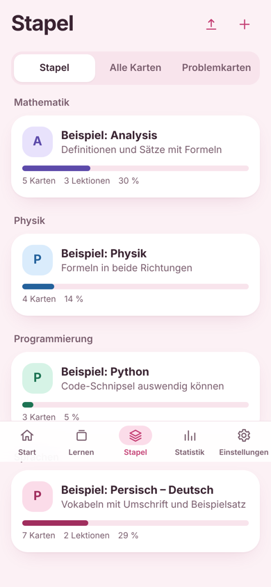
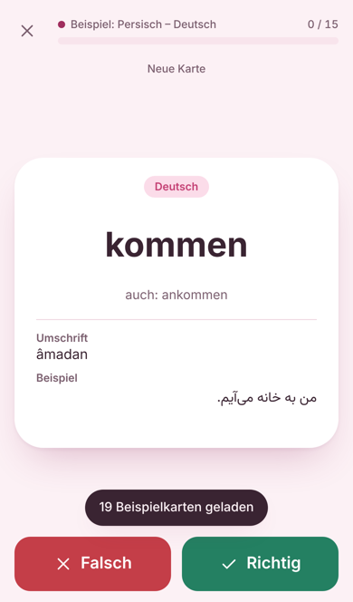
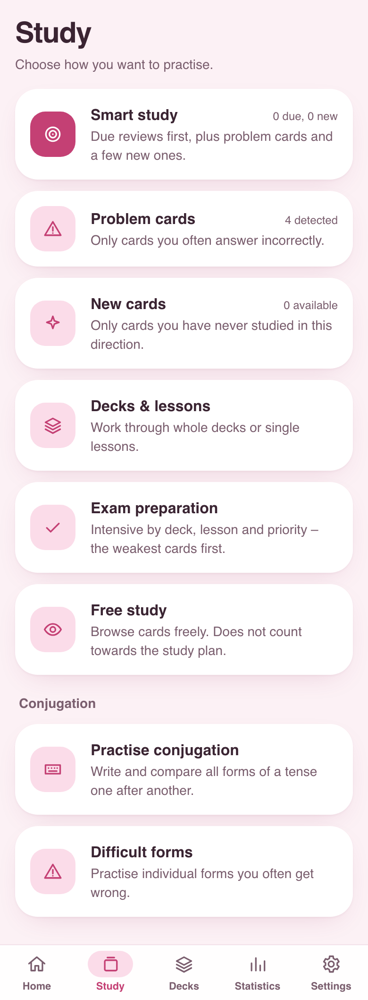
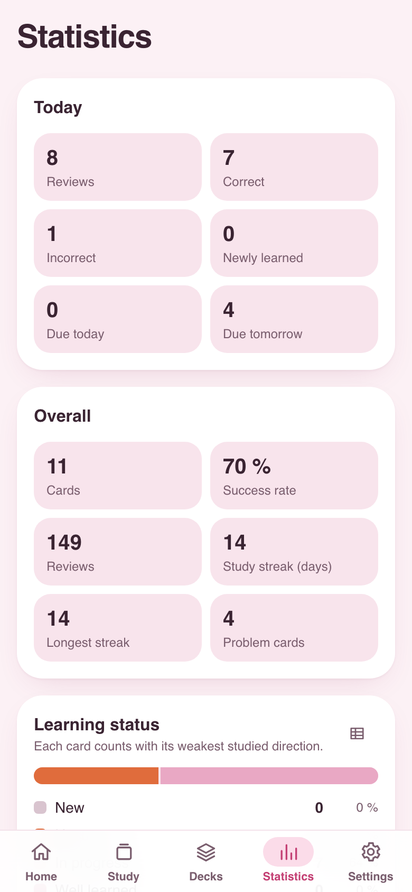
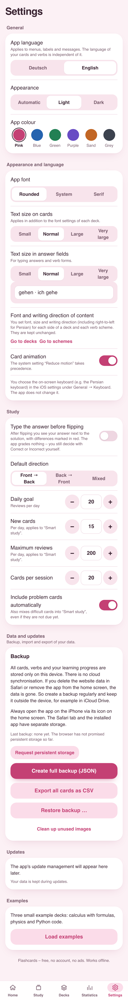

# Flashcards

Flashcard app for iPhone. Works offline. No account, no ads, no App Store.

Use it for vocabulary, formulas, definitions, code or anything else you want to memorise.

<p>
  
  
  
  
  
  
  
  
</p>

**Web app:** https://saya2810.github.io/flashcard-app/

## Install on iPhone

1. Open https://saya2810.github.io/flashcard-app/ in Safari.
2. Tap the Share button, then **Add to Home Screen**, then **Add**.
3. Open the app from the new icon on the Home Screen.
4. Open it once while online. After that it works offline.

- Always use the Home Screen icon, not the Safari tab. Both keep separate data.
- When a new version is published, the app asks you to update the next time it is online.

## Features

**Decks and cards**
- Decks grouped by subject, with optional lessons
- Each deck sets its own side labels, language, text direction, font and size
- Custom fields per deck (for example transliteration, example, source)
- Cards with notes, tags, a priority from 1 to 5 and several accepted answers
- Text with Markdown, LaTeX formulas, code blocks and images
- Right-to-left text (Persian, Arabic, Hebrew) displays correctly

**Learning**
- Flip the card, then mark it *Richtig* or *Falsch* yourself
- Optional typed-answer mode: type first, then see differences highlighted
- Spaced repetition (FSRS), tracked separately for both directions
- Problem cards are found automatically and can be practised on their own
- Study modes: smart review, problem cards, new cards, decks and lessons, exam preparation, free browsing
- Verb conjugation trainer with your own schemes (persons and tenses), for any language

**Statistics**
- Today, streaks, totals, success rate, daily activity, progress over time
- Hardest cards, 14-day forecast, statistics per deck and lesson
- Full review history per card

**Import, export, backup**
- CSV import into one or many decks and lessons, with column mapping and duplicate check
- CSV export
- Full JSON backup and restore (merge or replace)

**Other**
- German and English interface
- Light and dark mode
- Six colour schemes: pink, blue, green, purple, sand, grey
- Works offline, all data stored on the device

## Backups

- All data is stored only on the device. Deleting the app or clearing website data deletes everything.
- *Einstellungen → Vollständige Sicherung erstellen (JSON)* creates a backup file. Save it to iCloud Drive.
- Restore with *Zusammenführen* (adds only missing data) or *Alles ersetzen*.
- The app reminds you when the last backup is more than two weeks old.

## Run locally

Requires Node.js 20 or newer.

```bash
git clone https://github.com/Saya2810/flashcard-app.git
cd flashcard-app
npm install
npm run dev
```

Open http://localhost:5173.

| Command | Purpose |
|---|---|
| `npm run dev` | development server |
| `npm run build` | production build into `dist/` |
| `npm run preview` | run the production build locally |
| `npm test` | unit and component tests |
| `npm run test:e2e` | end-to-end tests (needs `npx playwright install chromium` once) |

## Host your own copy

The iPhone needs HTTPS to install the app. Upload the contents of `dist/` to any static host:

- GitHub Pages (used here, see `.github/workflows/deploy.yml`)
- Netlify Drop: drag `dist/` onto https://app.netlify.com/drop
- Cloudflare Pages: build command `npm run build`, output directory `dist`

## License

[MIT](LICENSE)
