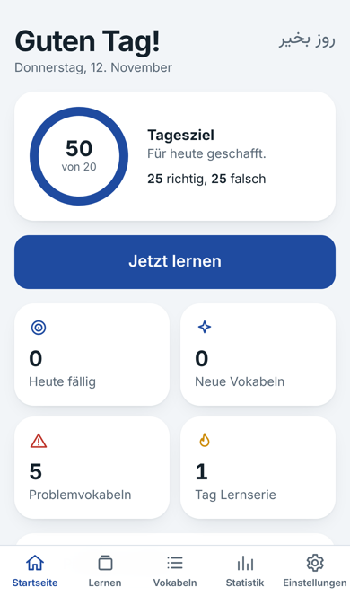
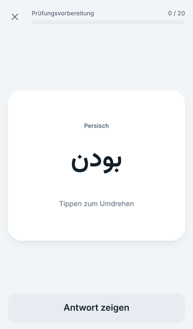
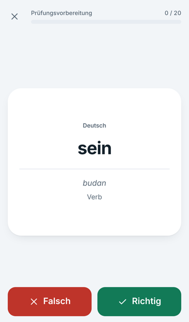
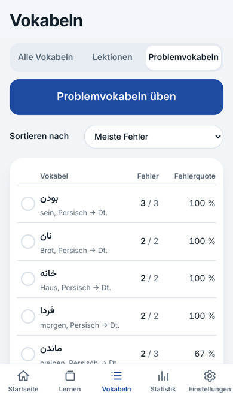

# Persisch Karten – Persian–German flashcards

A free, offline-first flashcard app for learning Persian (Farsi) ↔ German vocabulary on the iPhone.
It is a Progressive Web App: you open it once in Safari, add it to the Home Screen, and from then on it
runs like a native app – without the App Store, an account, a server or any subscription.

The user interface is in **German**; code, comments and documentation are in English.

<p>
  
  
  
  
</p>

## Features

- **Flashcards with exactly two buttons** – *Falsch* / *Richtig*. Tap to flip, no typing, no AI grading.
  Smooth 3D flip that respects “Reduce Motion”.
- **Real spaced repetition (FSRS)** via [`ts-fsrs`](https://github.com/open-spaced-repetition/ts-fsrs),
  adapted to binary feedback (see [Learning algorithm](#learning-algorithm)).
- **Both directions tracked separately** – Persian → German and German → Persian each have their own
  memory state, statistics and due dates.
- **Priority 1–5** per word that shortens review intervals without overriding the memory model.
- **Problem words** (*Problemvokabeln*) detected automatically, with sample-size safeguards, sorting by
  most mistakes / highest error rate / most recent mistake / weakest memory, and targeted practice.
- **Six study modes**: smart, problem words, new words, lesson, exam prep, free practice
  (the last one never touches the schedule).
- **Statistics**: today, totals, streaks, status distribution, daily activity, success rate, progress
  over time, hardest words, 14-day review forecast, per-lesson and per-word stats with full review history.
- **Vocabulary management**: unlimited words and lessons, multiple accepted translations, transliteration,
  grammar, example sentences, notes, tags, search, sort, filters, bulk move/delete, duplicate detection.
- **Import / export**: CSV import with column mapping, preview, validation and duplicate detection; quick
  paste (`آمدن ; kommen`); CSV export; full versioned JSON backup and safe restore (merge or replace).
- **Persian done properly**: RTL via `dir`/`lang` attributes (never reversed strings), bundled Vazirmatn
  font, search that treats Arabic ي/ك and Persian ی/ک (and more) as equal without altering stored text.
- **Offline & private**: everything lives in IndexedDB on the device; the service worker caches the app.
- Light and dark mode, adjustable card and Persian font sizes, iOS safe areas, large touch targets.

## Quick start (macOS)

Requires Node.js 20 or newer.

```bash
git clone https://github.com/Saya2810/flashcard-app.git
cd flashcard-app
npm install
npm run dev
```

Open http://localhost:5173.

> **zsh tip:** don’t paste `# comments` after commands – zsh treats `#` as an argument unless you run
> `setopt interactive_comments` (add it to `~/.zshrc` to make it permanent).

| Command | What it does |
|---|---|
| `npm run dev` | development server on http://localhost:5173 |
| `npm run build` | type-check and build the production app into `dist/` |
| `npm run preview` | serve the production build on http://localhost:4173 (with service worker) |
| `npm test` | 72 unit and component tests (Vitest + React Testing Library) |
| `npx playwright install chromium` | one-time browser download for the end-to-end tests |
| `npm run test:e2e` | 5 end-to-end tests against the production build in an iPhone viewport |

## Installing on the iPhone

### Local development is not deployment

`npm run dev` only listens on `localhost`, which the iPhone cannot reach. `npm run dev:netz` /
`npm run preview` also expose a LAN address (e.g. `http://192.168.1.20:4173`) that is fine for a quick
look on the phone – but service workers require **HTTPS**, so over plain `http://` there is no offline
mode and the app stops working once the Mac is off.

For real use, the contents of `dist/` must be served once over HTTPS. It is a static site, so free
hosting is enough. The iPhone downloads all assets on first launch; after that, no internet connection is
needed. Your vocabulary never leaves the phone – the host only serves the program code.

### Option A: GitHub Pages (this repository)

The workflow in `.github/workflows/deploy.yml` runs the tests, builds the app and publishes it on every
push to `main`. GitHub Pages must be set to **Settings → Pages → Source: GitHub Actions** once.
The app is then available at:

**https://saya2810.github.io/flashcard-app/**

The build uses relative paths (`base: './'`) and hash routing, so it works in a sub-path without changes.

### Option B: Netlify Drop

Run `npm run build`, open https://app.netlify.com/drop and drag the `dist` folder into the page.
Cloudflare Pages works too (build command `npm run build`, output directory `dist`).

### Add to Home Screen

1. Open the HTTPS URL in **Safari**.
2. Tap the Share button → **Add to Home Screen** → **Add**.
3. Launch the app from the new icon and wait for “Die App ist jetzt offline nutzbar”.

The Home Screen app and a regular Safari tab have **separate storage**. Use only the installed app. If you
already entered data in a tab, create a backup there and restore it in the installed app.

### Verify offline mode

Open the app once with a connection, close it, turn on Airplane Mode, open it from the icon, study a
session and look at the statistics. When a new version has been deployed, the app offers *Aktualisieren*
the next time it is online.

## Backups – please read

All data is stored only in the installed app’s IndexedDB. This is **not** cloud sync: deleting the app
from the Home Screen or clearing website data in iOS Settings deletes your vocabulary and progress.
The app asks the browser for persistent storage (`navigator.storage.persist()`), but that is not a
guarantee either.

- **Einstellungen → Vollständige Sicherung erstellen (JSON)** opens the iOS share sheet; save to
  iCloud Drive (“Save to Files”) or mail it to yourself.
- A backup contains all items, lessons, priorities, tags, every single review, scheduling states, daily
  statistics, sessions and settings. Backups are versioned and fully validated before anything is written.
- **Restore** shows what the file contains and then offers:
  - **Zusammenführen** (merge, default) – only adds what is missing; existing items and their progress are
    never overwritten.
  - **Alles ersetzen** (replace) – requires a second explicit confirmation and runs in a single
    transaction, so a failure leaves the old data intact.
- The home screen shows a gentle reminder when the last backup is older than two weeks.
- **CSV export** contains the word list only (for Excel/Numbers), not the learning progress.

## Project structure

```
src/
  types.ts              data types and default settings
  db/
    db.ts               Dexie schema, versioning, persistent-storage request
    repo.ts             items, lessons, priority, settings (with validation)
    import.ts           CSV column mapping, quick entry, duplicate detection
    backup.ts           JSON backup, validation, restore, CSV export
    sample.ts           load / remove sample data
  srs/
    scheduler.ts        FSRS wrapper (ts-fsrs), priority → target retention
    metrics.ts          problem-word rules, learning status, Wilson bound
    review.ts           recordAnswer(): stores one answer atomically
    queue.ts            session building per mode, re-queueing wrong cards
  stats/stats.ts        overview, daily series, forecast, lesson and problem statistics
  components/           Flashcard, charts (hand-written SVG), UI primitives, update prompt
  pages/                Home, Learn, Session, vocabulary list/form/detail, lessons,
                        problem words, import, statistics, settings
  lib/                  local-day date helpers, Persian normalisation, CSV
e2e/app.spec.ts         end-to-end tests
public/                 icons, beispiel.csv (sample import file)
```

Runtime dependencies: React, React Router, Dexie (+ hooks), ts-fsrs and the Vazirmatn font (bundled –
no request to Google Fonts). Charts are plain SVG.

## Data model

IndexedDB database `persisch-karten`, schema version 1 (`src/db/db.ts`):

| Table | Key | Contents |
|---|---|---|
| `vocab` | `id` | item fields, `lessonId`, `priority`, `tags` (multi-entry index), cached `status`/`problem` |
| `lessons` | `id` | name, description, last practised |
| `states` | `vocabId\|direction` | **one scheduling state per item and direction**: FSRS values, due date, counters, streaks |
| `reviews` | `id` | every answer: item, direction, timestamp, local day, correct/incorrect, session, kind, scheduling metadata |
| `sessions` | `id` | study sessions with mode and result |
| `days` | `YYYY-MM-DD` | daily activity and a snapshot of the status distribution |
| `settings` | `'app'` | settings |

Tags are not a separate table; they are derived from the multi-entry index on `vocab.tags`. Counters in
`states` and `days` are caches for fast queries – the full history is in `reviews`. Timestamps are epoch
milliseconds; calendar days are computed in local time and are DST-safe (`src/lib/dates.ts`).

**Migrations:** for schema changes, append a new `this.version(n).stores(…).upgrade(…)` in `db.ts`
(an example is in the comment there); Dexie runs missing steps when the database is opened. Backup files
carry their own format version; `migrateBackup()` in `backup.ts` is the place for future upgrades.
Backups from a newer app version are rejected.

## Learning algorithm

Three layers are kept strictly separate.

### 1. Long-term scheduling: FSRS

`ts-fsrs` with default parameters. Each item has, per direction, its own *stability* (days until the
probability of recall drops to 90 %) and *difficulty*.

| Button | FSRS rating |
|---|---|
| Richtig (correct) | Good |
| Falsch (incorrect) | Again |

Assumptions introduced by binary feedback:

- “Hard” and “Easy” are never used. Difficulty therefore decreases only slowly on correct answers and
  increases noticeably on every mistake, so intervals grow somewhat more cautiously than with four buttons.
- FSRS’s own minute-level learning steps are disabled (`enable_short_term: false`). FSRS sees exactly
  **one** rating per card and session: the first, unprepared answer.
- First answer correct → next review after about 2–3 days. First answer wrong → the next day.
- Due dates snap to the start of a local calendar day; “due on day X” applies from the morning.
- No interval fuzz; maximum interval 365 days.
- The parameters are the general defaults, not optimised on your own review history.

### 2. Short-term relearning within a session

A wrong card comes back in the same session after 4 other cards (or at the end if fewer remain), at most
3 times per session. These repeats are logged as *in-session repeats* but change neither FSRS nor the error
rate – otherwise one mistake would be counted several times.

### 3. Priority (1–5)

Priority does not change the memory state; it changes the **target retention**:

| Priority | 1 | 2 | 3 | 4 | 5 |
|---|---|---|---|---|---|
| Target | 80 % | 85 % | 90 % | 93 % | 95 % |

Important words are reviewed before they have faded as far as unimportant ones, i.e. shorter intervals
for the same memory state. Within a session, priority also weights urgency (0.8 to 1.2) and orders new
words. A frequently missed priority-5 word therefore appears much more often than a well-known priority-1
word. Changing the priority only recomputes the due date.

### Problem words

A direction is a problem word if any of these holds:

1. two or more mistakes in a row,
2. at least 4 answers and 3 or more mistakes among the last 6,
3. at least 5 answers, an error rate of 40 % or more and not yet 3 correct answers in a row.

A single mistake is not enough. Items with mistakes but fewer than 4 answers are listed separately under
*Noch zu wenig Daten* (not enough data). “Highest error rate” sorts by the lower Wilson bound so that
“2 of 2 wrong” does not outrank “8 of 12 wrong”. Words drop out again on their own once they recover.

### Learning status

Per direction:

| Status (UI) | Criterion |
|---|---|
| Neu (new) | never answered in a scheduled review |
| Unsicher (shaky) | problem word, or last answer incorrect |
| In Bearbeitung (in progress) | stability below 7 days |
| Gut gelernt (well learned) | stability of 7 days or more |
| Sicher beherrscht (mastered) | stability of 30 days or more and at least 3 correct answers in a row |

An item’s overall status is the weakest of the directions already practised.

## Study modes

| Mode (UI) | Selection | Affects schedule |
|---|---|---|
| Intelligentes Lernen (smart) | due cards by urgency; up to 20 % of the session for not-yet-due problem words; up to 25 % new words (capped by “new words per day”) | yes |
| Problemvokabeln | detected problem words, or individually selected words | yes |
| Neue Vokabeln | never practised in the chosen direction, high priority first | yes |
| Lektion lernen | everything in the chosen lessons: due, new, then the rest | yes |
| Prüfungsvorbereitung (exam prep) | choose lessons, priorities, number of cards and direction; weakest first | yes |
| Freies Lernen (free practice) | browse and flip cards | **no** – no answers, no statistics |

Ordering is always deterministic. In mixed direction, each item appears at most once per session, in its
more urgent direction; new words start with Persian → German.

## Import formats

**CSV** (UTF-8; comma, semicolon or tab; see `public/beispiel.csv`):

```
Persian,German,Transliteration,Lesson,Priority,Notes,Tags
آمدن,kommen | ankommen,âmadan,Lektion 3,5,,Verb
```

Separate multiple German translations with `|` and multiple tags with commas. Columns can be mapped freely
in the import screen; unknown lessons are created. Files that are not valid UTF-8 are rejected instead of
being imported as mojibake.

**Quick entry** (one item per line):

```
آمدن ; kommen
رفتن ; gehen, fahren ; raftan
```

Both show a preview with per-line errors and duplicates before importing.

## Testing status and known limits

Actually executed (Linux, Node 22):

- `npm test`: 72/72 passing.
- `npm run test:e2e`: 5/5 passing in Chromium with iPhone 14 emulation against the production build.
- `npm run build`: succeeds; about 590 KB precached for offline use.

Not verified:

- **No test on a real iPhone or in Safari/WebKit.** Layout, offline mode and persistence have only been
  verified in Chromium. Before relying on it, go through it once on the device: install, Airplane Mode,
  create and restore a backup.
- The iOS share sheet for saving backups is implemented but not tried on a device.
- Session building is tested with 5,000 items; the UI itself has not been hand-tested with that many.

Deliberate limitations: no sync between devices (transfer via backup file only), no reminder notifications.
Deleting an item keeps the daily activity counts but removes its individual review history.

## Kurzanleitung (Deutsch)

1. `npm install`, dann `npm run dev` und http://localhost:5173 öffnen.
2. Zum Installieren auf dem iPhone die Adresse https://saya2810.github.io/flashcard-app/ in Safari
   öffnen → Teilen → „Zum Home-Bildschirm“.
3. Die App immer über das Symbol öffnen und regelmäßig unter *Einstellungen* eine Sicherung erstellen –
   die Daten liegen nur auf dem Gerät.

## License

[MIT](LICENSE)
